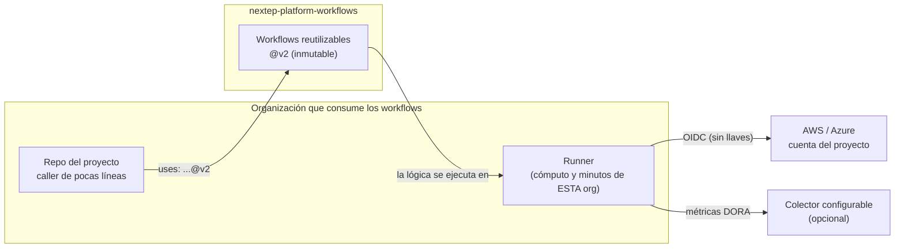

# nextep-platform-workflows

> El motor de CI/CD de Nextep: **workflows reutilizables de GitHub Actions**, versionados e inmutables.
> Ningún proyecto define su propio pipeline; todos **llaman** a estos.
> Qué se construye y en qué orden: [`SPEC.md`](./SPEC.md). Reglas para agentes: [`AGENTS.md`](./AGENTS.md).

**Estado:** P1 (`lego-aws-cicd` y `lego-aws-environment-deploy`) implementada y verificada **solo en local**
(bats, actionlint, shellcheck, gitleaks). **No verificado contra una cuenta AWS real**: spikes S1/S3/S4 e integración
en `dev` pendientes (`docs/adr/`, `test/sandbox/README.md`). Los releases (`vX.Y.Z` y el alias `v1`) los crea solo `release.yml`, un workflow manual que calcula la versión (`docs/runbook.md` §8).
La enmienda vigente sobre el resto del diseño está en `SPEC.md §0`; la guía de adopción en `docs/runbook.md`.

**Este repo es público.** No contiene secretos, cuentas cloud, URLs internas ni referencias a proyectos
concretos: todo lo específico entra por parámetros (`inputs`, `secrets`, `vars`) de quien llama. La seguridad
descansa en OIDC y en la identidad del workflow, no en ocultar la lógica.

---

## 1. Idea: Zero Copy-Paste CI/CD

Cuando cada repo copia su pipeline, el mismo "desplegar un ambiente" existe N veces con N bugs distintos: ARN
literales en el YAML, túneles con la verificación de TLS apagada, pipelines sin `concurrency` o sin rollback.
Cada copia envejece sola.

La regla: **el pipeline se escribe una vez, aquí, y los proyectos lo invocan por versión** (`@v2`). Un proyecto
solo declara *qué* es (ambiente, servicio, rol) y **no** *cómo* se construye, se prueba y se despliega.

- Corregir un bug del pipeline = un release aquí, no 30 PRs.
- Un proyecto nuevo tiene CI/CD correcto el día 1, sin que nadie lo diseñe.
- La seguridad no depende de que cada equipo recuerde la regla: está dentro del workflow.

---

## 2. Cómo funciona (en una pantalla)



- **La lógica vive aquí; el cómputo corre en la organización de quien llama.** Los secretos y la cuenta cloud
  nunca salen de esa organización.
- **Sin credenciales estáticas.** El runner se autentica contra AWS/Azure por OIDC. El rol en la nube solo
  acepta tokens emitidos por **este** workflow (condición `job_workflow_ref`): un pipeline "propio" en el
  repo consumidor, aunque pida el mismo rol, es rechazado.
- **Gobernanza en el repo del proyecto:** `CODEOWNERS` protege `.github/workflows/`, y el proyecto cumple el
  contrato del `Makefile` universal (`make lint`, `make test-ci`, …) que los workflows ejecutan.

---

## 3. Catálogo

| Workflow | Estado | Para qué |
|---|---|---|
| `lego-aws-cicd` | Implementado (P1) | Flujo rápido: gate → migración (si hay pendientes, túnel SSM) → deploy. `compute: lambda \| ecs` |
| `lego-aws-environment-deploy` | Implementado (P1) | Ambiente completo: gate → infra (sin el stack del rol OIDC) → migraciones → verificación → seed; rollback por `image-tag` |
| `lego-aws-image-publish` | Implementado (sin liberar) | Una imagen de un repo que la distribuye: por el push de un tag `vX.Y.Z` la construye, la sube a ECR como `X.Y.Z` (nunca `latest`) y emite su **digest**. Sin BD, sin deploy, sin telemetría. `docs/runbook.md` §10 |
| `lego-node-ci` | Implementado (sin liberar) | CI de un repo Node/pnpm: instalación inmutable, `pnpm test`, `pnpm typecheck`. Sin nube. `docs/runbook.md` §9 |
| `lego-package-release` | Implementado (sin liberar) | Un paquete npm como tarball de un GitHub Release (sin registry): gate (tag == versión, tests, un `npm pack` revisado, sha256) → release (crea y verifica; nunca reescribe). Sin nube. `docs/runbook.md` §9 |
| `lego-azure-satellite` | Diseño | Satélites Core–Satélite en Azure. Fuera de P1 |

Los dos de AWS son por **flujo**, no por cómputo (`SPEC.md §0`). Secuencia del rápido:
**`quality-and-security-gate` → `database-migration` → `deploy`**. Un job final opcional, `telemetry-phone-home`,
reporta el despliegue a un colector DORA si lo configuras (sección 4).

**Minutos contados.** Cada job es un runner que repite checkout, toolchain e install. En `lego-aws-environment-deploy`,
con `migrate-before-deploy: true` la migración y el `post-deploy-command` corren como **pasos** de `infra-deploy`
(mismo rol, mismo install): el run son dos runners, `quality-and-security-gate` → `infra-deploy`. Solo el orden
infra → migración mantiene jobs aparte (`database-migration`, `post-deploy`), porque la migración debe esperar a la infra.

**Entradas opcionales de la v1.3.0** (aditivas: sin ellas todo se comporta como en la v1.2):

| Input | Workflow | Qué hace |
|---|---|---|
| `python-version` + `python-requirements` | ambos | Instala Python (con caché de pip) y los requisitos **fijados** (`==` o hashes) antes de lint, tests y migración. Van juntos. Node sigue instalándose. Ver `docs/runbook.md` §1.1 |
| `migrate` (default `true`) | `lego-aws-environment-deploy` | `false` apaga toda la etapa de base de datos de un servicio `ecs`/`lambda` sin BD (sin túnel ni job de migración) y rechaza los inputs `db-*` con valor. Ver `docs/runbook.md` §1.2 |

Además cada ejecución **le cuenta lo que pasó** a quien la lee: un resumen en la pestaña del run y un comentario
en el PR cuando falla un gate o termina un deploy, con enlace directo al log.

---

## 4. Telemetría DORA ("phone home"), sin sorpresas

> **Opt-in:** sin `telemetry-url` **y** `telemetry-audience` el job se omite y no se envía nada.

El último job de cada workflow (`telemetry-phone-home`) envía **un evento de despliegue** a un colector **que tú configuras**
(`telemetry-url` y `telemetry-audience`, ambos desde `vars` del repo), siempre (`always()`), incluso si el deploy falló. Sirve para medir
frecuencia de despliegue, lead time, tasa de fallos y tiempo de recuperación. Se autentica con un **token OIDC de GitHub** (sin secretos
compartidos); el job no hace checkout, no ejecuta comandos tuyos y no tiene credenciales de ninguna nube.

- **Qué se envía:** repositorio, ambiente, resultado, duración por etapa, commit (con su árbol y su ancestría) y tiempos. El esquema exacto
  está en `contracts/telemetry.schema.json` y el payload **se imprime en el resumen de cada run**: puedes ver lo que salió.
- **Qué no se envía:** código, diffs, secretos, variables de entorno, logs, **ni quién lanzó el run**.
- **Nunca rompe un deploy:** si el colector no responde, el pipeline sigue en verde (el job y su paso no fallan el run). Para reenviar:
  *Re-run job* `telemetry-phone-home`.
- **Llámalo por tag** (`@v2` o `@vX.Y.Z`): el colector solo acepta tokens emitidos por un workflow de este repo en un tag.
- Diseño completo: `docs/specs/telemetria-dora/SPEC.md`.

---

## 5. Estructura

```
nextep-platform-workflows/
├── README.md   ← la idea (este archivo)
├── SPEC.md     ← contratos, secuencia de jobs, plan por fases
├── AGENTS.md   ← reglas para agentes (CLAUDE.md lo importa)
├── .github/workflows/  lego-aws-cicd, lego-aws-environment-deploy, lego-aws-image-publish, self-ci
├── .github/actions/    composites internos (aws-oidc, ssm-tunnel, migrate, infra-deploy, ...)
├── scripts/            lógica en bash, con tests
├── contracts/          contratos máquina-legibles de cada workflow
├── test/               bats, gates por disco, fixtures, sandbox/callers
└── docs/               adr/ (spikes), iam/, parity/ (matriz), exceptions.yml, runbook.md
```

## Política de paquetes `@nextep/*` por ambiente (`v2.0.0`)

Desde `v2.0.0`, `lego-aws-cicd` y `lego-aws-environment-deploy` **exigen** la evidencia de paquetes según el ambiente: en `dev` y `stg` un repo sin `root-kinds`, con un paquete requerido faltante o con el guard de paquetes en rojo **no despliega**; en `prod` los mismos hallazgos son **warning** y nunca frenan la entrega (hotfix y rollback incluidos). El modo sale solo del input `environment`: no existe ningún input que lo apague o lo baje. Qué se evalúa, cómo leer un ❌/⚠️, cómo adoptar y cómo se sube el mínimo de un paquete: `docs/runbook.md` sección 12. Un major exige actualizar antes las trust policies (`docs/iam/README.md`); `v1` sigue disponible y no se mueve.
