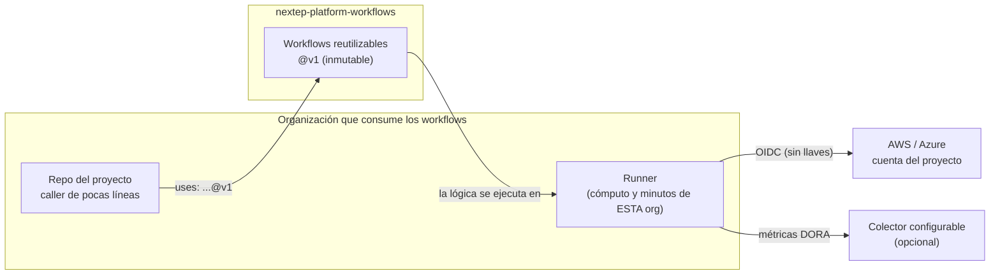

# nextep-platform-workflows

> El motor de CI/CD de Nextep: **workflows reutilizables de GitHub Actions**, versionados e inmutables.
> Ningún proyecto define su propio pipeline; todos **llaman** a estos.
> Qué se construye y en qué orden: [`SPEC.md`](./SPEC.md). Reglas para agentes: [`AGENTS.md`](./AGENTS.md).

**Estado:** diseño. No hay workflows implementados todavía; se construyen por fases, empezando por un solo
proyecto piloto (ver `SPEC.md §11`).

**Este repo es público.** No contiene secretos, cuentas cloud, URLs internas ni referencias a proyectos
concretos: todo lo específico entra por parámetros (`inputs`, `secrets`, `vars`) de quien llama. La seguridad
descansa en OIDC y en la identidad del workflow, no en ocultar la lógica.

---

## 1. Idea: Zero Copy-Paste CI/CD

Cuando cada repo copia su pipeline, el mismo "desplegar un ambiente" existe N veces con N bugs distintos: ARN
literales en el YAML, túneles con la verificación de TLS apagada, pipelines sin `concurrency` o sin rollback.
Cada copia envejece sola.

La regla: **el pipeline se escribe una vez, aquí, y los proyectos lo invocan por versión** (`@v1`). Un proyecto
solo declara *qué* es (ambiente, servicio, rol) y **no** *cómo* se construye, se prueba y se despliega.

- Corregir un bug del pipeline = un release aquí, no 30 PRs.
- Un proyecto nuevo tiene CI/CD correcto el día 1, sin que nadie lo diseñe.
- La seguridad no depende de que cada equipo recuerde la regla: está dentro del workflow.

---

## 2. Cómo funciona (en una pantalla)



- **La lógica vive aquí; el cómputo corre en la organización de quien llama.** Los secretos y la cuenta cloud
  nunca salen de esa organización.
- **Sin credenciales estáticas.** El runner se autentica contra AWS/Azure por OIDC. El rol en la nube solo
  acepta tokens emitidos por **este** workflow (condición `job_workflow_ref`): un pipeline "propio" en el
  repo consumidor, aunque pida el mismo rol, es rechazado.
- **Gobernanza en el repo del proyecto:** `CODEOWNERS` protege `.github/workflows/`, y el proyecto cumple el
  contrato del `Makefile` universal (`make lint`, `make test-ci`, …) que los workflows ejecutan.

---

## 3. Catálogo

| Workflow | Para qué |
|---|---|
| `lego-aws-ecs` | Servicios en ECS: build multi-stage, push a ECR, migraciones de BD y despliegue con circuit breaker |
| `lego-aws-lambda` | Single-Use Lambdas y Lambdaliths (incluido multi-tenant) |
| `lego-azure-satellite` | Satélites de una arquitectura Core–Satélite en Azure (Container Apps / Web Apps) |

Los tres siguen la misma secuencia de jobs:
**`quality-and-security-gate` → `database-migration` → `deploy` → `telemetry-phone-home`**.

Además cada ejecución **le cuenta lo que pasó** a quien la lee: un resumen en la pestaña del run y un comentario
en el PR cuando falla un gate o termina un deploy, con enlace directo al log.

---

## 4. Telemetría DORA ("phone home"), sin sorpresas

El último job de cada workflow envía **una métrica de despliegue** a un colector **que tú configuras**
(`telemetry-url`; si lo dejas vacío, no se envía nada), siempre (`if: always()`), incluso si el deploy falló. Sirve para medir frecuencia de despliegue, lead time, tasa de
fallos y tiempo de recuperación.

- **Qué se envía:** repositorio, ambiente, resultado, duración por etapa, commit y tiempos. El payload exacto
  está en `SPEC.md` y **se imprime en el resumen de cada run**: puedes ver lo que salió.
- **Qué no se envía:** código, diffs, secretos, variables de entorno, logs.
- **Nunca rompe un deploy:** si el colector no responde, el pipeline sigue en verde.

---

## 5. Estructura

```
nextep-platform-workflows/
├── README.md   ← la idea (este archivo)
├── SPEC.md     ← contratos, secuencia de jobs, plan por fases
├── AGENTS.md   ← reglas para agentes (CLAUDE.md lo importa)
└── (se crean por fase) .github/workflows/  .github/actions/  scripts/  contracts/  test/  docs/
```
