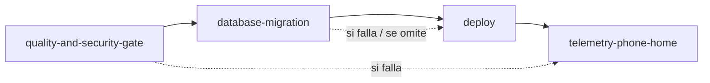

# SPEC — nextep-platform-workflows

> Hoja de ruta de ingeniería del motor de CI/CD. Contexto e idea: [`README.md`](./README.md).
> **Estado: BORRADOR — pendiente de aprobación. No se escribe ningún workflow hasta aprobarlo.**
>
> **Cómo leerlo:** §3–§9 son el **diseño objetivo** (contratos y mecanismos). §11 es lo que se construye
> **ahora**: un proyecto piloto, registrando patrones existentes antes de implementar, fase por fase. Lo que no
> está en F0–F2 es backlog.

| | |
|---|---|
| **Repo** | `Nextep-xyz/nextep-platform-workflows` |
| **Versión del spec** | 0.1.0 (2026-10-29) |
| **Aprobador** | Mantenedores del repo (ver `.github/CODEOWNERS`) |
| **Ejecutor previsto** | Agente autónomo, fase por fase (§11), o un DevOps sin contexto de la conversación |
| **Lo que NO está verificado** | Marcado como **[SPIKE]** en §3. Se resuelve en F0 antes de implementar |
| **Preguntas bloqueantes** | §13 (`[bloquea F#]`) |

---

## 1. Problema y alcance

**Problema.** El pipeline "desplegar un ambiente" existe copiado en cada repo (§2) y divergió: ARN literales,
verificación de TLS desactivada, un pipeline sin `concurrency`, otros sin rollback. Con decenas de proyectos y varias organizaciones
consumiendo los mismos pipelines, cada corrección es N PRs y cada proyecto nuevo reinventa el pipeline.

**Entra:**

- Tres workflows reutilizables (`workflow_call`): `lego-aws-ecs`, `lego-aws-lambda`, `lego-azure-satellite`.
- Secuencia común de jobs: `quality-and-security-gate` → `database-migration` → `deploy` → `telemetry-phone-home`.
- Autenticación OIDC (AWS/Azure) acotada por `job_workflow_ref`.
- Migraciones por **Bastión SSM** (sin SSH) y por **task en la VPC**.
- "Pipeline Chismoso": resumen del run + comentario en el PR con enlaces a logs.
- Telemetría DORA (payload y `curl` resiliente definidos aquí).
- El contrato que el repo hijo debe cumplir (`Makefile`, `CODEOWNERS`, caller).

**Queda explícitamente fuera:**

- **Desplegar infraestructura** (`cdk deploy` de stacks completos, `terraform apply`). Estos workflows despliegan
  la **aplicación** (imagen/código) y migran la BD. El despliegue de infra es otro workflow, backlog. Motivo
  concreto: el stack que crea el rol OIDC no debe desplegarse desde el run que lo usa (§2).
- El **colector** de telemetría (este repo define el contrato del payload, no el servicio).
- Escribir los workflows en esta etapa: el SPEC define contratos; la implementación entra por fase.
- Workflows de Core de Azure (`lego-azure-core`), Terraform, previews por PR, notificaciones a Slack. Backlog.
- Migrar los proyectos existentes. Se prueba **contra** sus patrones, no se les modifica el repo, hasta que cada
  equipo adopte (§11).
- Los módulos de infraestructura, las plantillas de proyecto y las políticas de gobernanza: viven fuera de este
  repo. Aquí solo se define el contrato que el repo consumidor debe cumplir (§5).

---

## 2. Requisitos de diseño (qué se evita y qué se hace en su lugar)

> Derivado de la experiencia con pipelines copiados de repo en repo. El inventario detallado de los pipelines
> internos preexistentes se mantiene **en un repositorio privado**, nunca aquí: este repo es **público**.

| Se evita (antipatrón habitual) | Se hace en su lugar |
|---|---|
| Rama → ambiente y ARN del rol **literales en el YAML** | El caller pasa el rol por `vars` del Environment; este repo no contiene ninguna cuenta |
| Migrar desde el runner con credenciales de BD en el entorno y la verificación de TLS apagada | Dos modos: `ecs-task` (**recomendado**: el runner no ve credenciales) y `ssm-tunnel` endurecido (§7) |
| Esperar el túnel con `sleep` fijo | *Polling* con *timeout* y detección de proceso muerto |
| Credenciales escritas a `$GITHUB_ENV` | Solo en el `env:` del paso que las usa |
| Sin `concurrency`, o cancelando deploys a medias | `concurrency` por proyecto+ambiente, `cancel-in-progress: false` |
| Sin forma de volver atrás sin reconstruir | **Rollback por `image-tag`** de primera clase (§6) |
| Tests de infra que corren pero no bloquean | El gate es un job con nombre fijo, pensado para ser *required check* |
| Desplegar el stack que crea el propio rol OIDC desde el run que lo usa | Fuera de alcance de estos workflows (§1) |
| Un pipeline distinto por gestor de paquetes | Soporte de `npm` y `pnpm`, `.nvmrc` o versión explícita |

## 3. Decisiones de arquitectura y spikes

### 3.1 Cómo se ejecuta un workflow reutilizable (hechos de la plataforma)

- Un `workflow_call` corre **en el contexto del caller**: sus jobs usan los **runners de la organización que
  llama**, con sus minutos, su `GITHUB_TOKEN` y sus secretos. La lógica se **lee** de este repo.
- Los `permissions` del `GITHUB_TOKEN` en el workflow llamado **no pueden exceder** los del caller. El caller
  debe conceder `id-token: write`, `contents: read` y `pull-requests: write`.
- Los secretos no se heredan sin `secrets: inherit` o paso explícito. `env` del caller no pasa.
- Un job del workflow llamado con `environment:` usa los **Environments del repo caller** (reglas de aprobación,
  variables). Así se implementa la aprobación manual de prod.
- Los `inputs` solo pueden ser `string`, `number` o `boolean`. Las listas viajan como **string JSON**.
- El nombre del *status check* de un job llamado es `<job-id del caller> / <name del job llamado>`. Los
  `name:` de los jobs de este repo son, por tanto, **parte del contrato** (§5): cambiarlos rompe los *required
  checks* de todos los proyectos.

### 3.2 Decisiones

| # | Decisión | Motivo | Riesgo |
|---|---|---|---|
| **D1** | **Este repo es público** (decidido). Un workflow reutilizable en un repo **privado** solo lo pueden llamar repos de la misma organización (o empresa); el repo público es la forma de que organizaciones distintas lo llamen sin duplicarlo. Plan B: un **mirror** por organización consumidora | El mirror multiplica los repos a mantener y rompe "un release, todos corrigen" | La lógica del pipeline es pública. Por eso **cero secretos, cuentas, URLs ni nombres internos** en el repo (todo entra por `inputs`/`secrets`/`vars` del caller) y la seguridad descansa en OIDC + `job_workflow_ref`, no en ocultar la lógica (G13) |
| **D2** | **OIDC acotado por `job_workflow_ref`.** El rol cloud solo acepta tokens cuyo `job_workflow_ref` sea un workflow de este repo (`Nextep-xyz/nextep-platform-workflows/.github/workflows/lego-aws-ecs.yml@refs/tags/v1`), además de `sub` (repo + environment) | Un `deploy.yml` propio en el repo consumidor no puede asumir el rol aunque conozca el ARN | El tag `v1` es **móvil** (alias). Se protege con ruleset de tags: solo `release.yml` puede crear/mover `v1*` (D4). Los callers usan `@v1`, no SHA: un SHA no coincide con la condición |
| **D3** | **Acceso del workflow a sus propios composites/scripts.** `uses: ./.github/actions/x` dentro de un reusable resuelve contra el repo del **caller**, no este. Se usa `uses: Nextep-xyz/nextep-platform-workflows/.github/actions/x@<SHA>` y `release.sh` reescribe las referencias internas al SHA del release | Referencias estáticas y auditables; el workflow `@v1` siempre usa los composites de **ese** release | Hay que probar que la reescritura no deja referencias a `@main` (gate G11) |
| **D4** | **Releases inmutables, alias controlado.** Tags `vX.Y.Z` inmutables; `vX` móvil, ambos bajo ruleset (solo la automatización de release; sin borrado ni *force push*) | "Inmutable" real = nadie, ni un admin distraído, mueve un tag a mano | Un compromiso de la cuenta de release mueve `v1`: releases firmados + 2 aprobadores |
| **D5** | **Concurrency a nivel de job**: gate `cancel-in-progress: true` por ref; migración/deploy `group: deploy-lock-<project>-<environment>`, `cancel-in-progress: false` | Cortar un deploy a medias deja stacks/servicios a medias | — |
| **D6** | **Un solo rol por (proyecto, ambiente), mínimo privilegio.** Sin roles compartidos entre ambientes | Blast radius | Más roles; los provisiona el IaC de cada proyecto |
| **D7** | **Todo `${{ inputs.* }}` va a `env:`, nunca interpolado en `run:`** | Inyección de comandos vía inputs | Gate G5 |

### 3.3 Spikes (resolver en F0; hasta entonces estas afirmaciones **no están verificadas**)

| Spike | Qué hay que comprobar | Si falla |
|---|---|---|
| **S1** | IAM (AWS) acepta `token.actions.githubusercontent.com:job_workflow_ref` como *condition key* en la trust policy de un proveedor OIDC de GitHub | Personalizar el claim `sub` del repo/org con `include_claim_keys` que incluya `job_workflow_ref` y condicionar sobre `sub` |
| **S2** | Azure Entra permite condicionar un federated credential por `job_workflow_ref` (identidades federadas flexibles) | Mismo fallback del `sub` personalizado; si tampoco, Azure queda con `sub` por environment y se documenta el hueco |
| **S3** | Un repo en **otra organización** puede llamar al reusable público, y un repo consumidor **con un workflow propio** recibe `AccessDenied` al asumir el rol (**prueba negativa**) | Cambiar a mirror por organización (D1-B) |
| **S4** | Tunel SSM + `verify-full`: añadir `127.0.0.1 <endpoint-rds>` a `/etc/hosts` y usar el bundle de CA de RDS permite verificación completa con Prisma/pg | Degradar a `sslmode=require` (cifra, no verifica) con ADR explícito; nunca `NODE_TLS_REJECT_UNAUTHORIZED=0` |
| **S5** | Los composites referenciados por SHA se resuelven desde un reusable llamado cross-org | Revisar D3 (checkout de este repo en `job.workflow_sha` si el contexto está disponible) |

---

## 4. Árbol de directorios exacto

```
nextep-platform-workflows/
├── README.md
├── SPEC.md
├── AGENTS.md
├── CLAUDE.md                              # "@AGENTS.md"
├── .github/
│   ├── CODEOWNERS
│   ├── workflows/
│   │   ├── lego-aws-ecs.yml               # reusable (workflow_call)         — F1
│   │   ├── lego-aws-lambda.yml            # reusable                         — F2
│   │   ├── lego-azure-satellite.yml       # reusable                         — F3
│   │   ├── self-ci.yml                    # CI de ESTE repo (NO es reusable) — F0
│   │   └── release.yml                    # tags vX.Y.Z, alias vX, reescritura de SHAs — F3
│   └── actions/                           # composites, referenciados por SHA (D3)
│       ├── validate-inputs/action.yml
│       ├── aws-oidc/action.yml
│       ├── azure-oidc/action.yml
│       ├── quality-gate/action.yml        # lint, test-ci, gitleaks, trivy
│       ├── ssm-tunnel/action.yml
│       ├── pipeline-report/action.yml     # $GITHUB_STEP_SUMMARY + comentario de PR
│       └── telemetry/action.yml
├── scripts/                               # bash; todo con `set -euo pipefail`
│   ├── lib/common.sh                      # log, mask, die, retry
│   ├── lib/versions.env                   # versiones y sha256 pineados (plugin SSM, bundle CA RDS)
│   ├── validate-inputs.sh
│   ├── ecs-verify-image.sh
│   ├── ecs-assert-circuit-breaker.sh
│   ├── ecs-deploy.sh
│   ├── ecs-run-migration-task.sh
│   ├── bastion-ready.sh
│   ├── fetch-db-secret.sh
│   ├── ssm-tunnel-up.sh
│   ├── ssm-tunnel-down.sh
│   ├── wait-for-port.sh
│   ├── pipeline-report.sh
│   ├── build-telemetry-payload.sh
│   ├── send-telemetry.sh
│   └── release.sh
├── contracts/                             # fuente de verdad MÁQUINA-LEGIBLE de §6
│   ├── lego-aws-ecs.contract.yml          # inputs, secrets, outputs, jobs[].name
│   ├── lego-aws-lambda.contract.yml
│   ├── lego-azure-satellite.contract.yml
│   └── telemetry.schema.json              # JSON Schema del payload de §9
├── test/
│   ├── bats/                              # unitarias de scripts (con aws/az/curl falsos)
│   ├── gates/                             # invariantes por DISCO (§10)
│   ├── fixtures/                          # payloads, respuestas de aws, workflows malos
│   └── sandbox/                           # proyecto sandbox que llama a los workflows (F1+)
└── docs/
    ├── iam/                               # trust policy y política mínima (ejemplos)
    ├── adr/                               # decisiones (S1–S5 se cierran aquí)
    └── runbook.md                         # qué hacer cuando el pipeline falla / colector caído
```

Los directorios se crean **en la fase que los necesita**; no se dejan vacíos por adelantado.

---

## 5. Contrato con el repo hijo

El proyecto que llama a estos workflows debe cumplir lo siguiente. El `Makefile` y `CODEOWNERS` los provee la plantilla de proyecto de la organización (fuera de este repo).

### 5.1 Targets del `Makefile` que los workflows ejecutan

| Target | Lo ejecuta | Contrato |
|---|---|---|
| `make lint` | gate | Sale ≠ 0 si hay errores de estilo/estáticos. Sin red, sin secretos |
| `make test-ci` | gate | Tests + validación de IaC (lo mismo que en local) |
| `make build` | gate/deploy | Genera artefactos (lambdas/bundles). **Opcional** si solo hay imagen Docker |
| `make migrate` | migración | Aplica migraciones usando `DATABASE_URL` del entorno. Idempotente |
| `make migrate-status` | migración | Sale ≠ 0 si la BD no está alineada con las migraciones del repo |

El gate ejecuta `make -n <target>` antes de correr: si falta un target obligatorio, **falla con el nombre del
target** (no con un "No rule to make target" enterrado en el log).

> **Dependencia cruzada:** si la plantilla de proyecto no define `lint`, `build`, `migrate` y `migrate-status`,
> hay que añadirlos allí (fuera de este repo; §13, Q6).

### 5.2 Caller (lo único que un proyecto escribe)

```yaml
# .github/workflows/deploy.yml  (bloqueado por CODEOWNERS)
name: deploy
on: { push: { branches: [main] } }
permissions: { id-token: write, contents: read, pull-requests: write }
jobs:
  deploy:                              # el id del job es parte del nombre del required check
    uses: Nextep-xyz/nextep-platform-workflows/.github/workflows/lego-aws-ecs.yml@v1
    with:
      project: shop
      environment: prod
      role-arn: ${{ vars.AWS_ROLE_ARN }}
      ecs-cluster: shop-prod
      ecs-service: shop-prod-api
      container-name: api
      ecr-repository: shop-api
    secrets: inherit
```

Para PR, otro caller con `run-deploy: false` y el job id `ci`. Los **required checks** de `main` son:
`ci / quality-and-security-gate` y `deploy / quality-and-security-gate`.

### 5.3 Gobernanza del repo hijo

- `.github/CODEOWNERS` protege `/.github/workflows/` con el equipo de DevOps. Ruleset de
  `main` con *Require review from Code Owners* y los required checks anteriores.
- **Environments** `dev`, `stg`, `prod` creados en el repo, con `vars.AWS_ROLE_ARN` (o `AZURE_*`) por ambiente.
  `prod` con revisores requeridos (aprobación manual) y limitado a la rama `main`.
- La **GitHub Action permitida** en la org se limita (allowlist) y el repo hijo **no** define otros workflows
  de deploy. Un chequeo de conformidad de la organización lo audita.

---

## 6. Contrato técnico de los reusable workflows

> La fuente de verdad **ejecutable** es `contracts/*.contract.yml`; un gate por disco (G12) compara cada
> workflow contra su contrato. Las tablas de abajo se **derivan** de ahí. Si discrepan, manda el contrato.

### 6.1 Contrato común (los tres workflows)

| Input | Tipo | Req. | Default | Notas |
|---|---|---|---|---|
| `project` | string | ✔ | — | Prefijo corto del proyecto (`shop`, `billing`…). `^[a-z][a-z0-9-]{1,15}$` |
| `environment` | string | ✔ | — | `dev` \| `stg` \| `prod`. Se mapea al GitHub Environment del caller |
| `run-deploy` | boolean | – | `true` | `false` = solo `quality-and-security-gate` (PR) |
| `runner` | string | – | `ubuntu-latest` | Label del runner (permite runners self-hosted) |
| `package-manager` | string | – | `pnpm` | `npm` \| `pnpm` |
| `node-version-file` | string | – | `.nvmrc` | Si no existe, falla pidiendo `node-version` |
| `node-version` | string | – | `""` | Alternativa a `node-version-file` |
| `trivy-severity` | string | – | `HIGH,CRITICAL` | Permitidos: `CRITICAL`, `HIGH,CRITICAL`, `MEDIUM,HIGH,CRITICAL`. **No se puede relajar** |
| `image-tag` | string | – | `""` | **No vacío = modo rollback**: no construye, verifica que exista, **no migra** |
| `migration-mode` | string | – | `none` | AWS: `none` \| `ssm-tunnel` \| `ecs-task`. Azure: `none` \| `aca-job` |
| `migration-command` | string | – | `make migrate` | |
| `migration-verify-command` | string | – | `make migrate-status` | |
| `migration-timeout-minutes` | number | – | `20` | |
| `telemetry-enabled` | boolean | – | `true` | Ver §9 |
| `telemetry-url` | string | – | `""` | Vacío = se omite con aviso (no falla) |

| Secret | Req. | Uso |
|---|---|---|
| `TELEMETRY_TOKEN` | – | Clave HMAC del webhook de telemetría |
| `NPM_TOKEN` | – | Registry privado (p. ej. GitHub Packages para `@nextep/*`) |

**No hay secretos cloud:** AWS/Azure entran por OIDC. **No existe** un input para desactivar el escaneo ni para
relajar su severidad (un workflow que permite apagar el gate no es un gate).

| Output | Descripción |
|---|---|
| `status` | `success` \| `failure` \| `cancelled` |
| `deployed` | `true` si el servicio/función quedó actualizado |
| `image-tag` | Tag desplegado |
| `previous-image-tag` | Tag que corría antes (para el comando de rollback del reporte) |
| `run-url` | URL del run |

### 6.2 `lego-aws-ecs.yml` — inputs adicionales

| Input | Tipo | Req. | Default | Notas |
|---|---|---|---|---|
| `aws-region` | string | – | `us-east-2` | |
| `role-arn` | string | ✔ | — | De `vars.AWS_ROLE_ARN` del Environment. Nunca literal |
| `ecs-cluster` / `ecs-service` | string | ✔ | — | |
| `container-name` | string | ✔ | — | Contenedor cuya imagen se reemplaza en la task definition |
| `ecr-repository` | string | ✔ | — | |
| `dockerfile` / `docker-context` | string | – | `Dockerfile` / `.` | |
| `build-targets` | string (JSON) | – | `[{"target":"runner","suffix":""}]` | Multi-stage. Con imagen de migraciones: añade `{"target":"migrator","suffix":"-migrator"}` |
| `deploy-timeout-minutes` | number | – | `15` | Espera a `services-stable` |
| `bastion-id-ssm-param` | string | – | `""` | Req. si `ssm-tunnel`. **Nombre** del parámetro SSM con el instance-id |
| `db-endpoint-ssm-param` | string | – | `""` | Req. si `ssm-tunnel` |
| `db-secret-id` | string | – | `""` | Req. si hay migración. Secreto con `username`/`password` |
| `db-name` | string | – | `""` | |
| `db-port` | number | – | `5432` | También puerto local del túnel |
| `db-ssl-mode` | string | – | `verify-full` | `verify-full` \| `require` (S4) |
| `db-url-template` | string | – | `postgresql://{user}:{password}@{host}:{port}/{db}?sslmode={sslmode}` | Placeholders; `{password}` se URL-encodea |
| `migration-task-family` | string | – | `""` | Req. si `ecs-task` |
| `migration-container-name` | string | – | `""` | Req. si `ecs-task` |
| `migration-network-ssm-param` | string | – | `""` | Req. si `ecs-task`: parámetro con subredes y SG |

### 6.3 `lego-aws-lambda.yml` — inputs adicionales

Mismos `aws-region`, `role-arn`, `db-*`, `migration-*` y `bastion-*` que ECS, más:

| Input | Tipo | Req. | Default | Notas |
|---|---|---|---|---|
| `form` | string | ✔ | — | `single-use` \| `lambdalith` (informativo y para telemetría; el deploy es igual) |
| `deploy-mode` | string | ✔ | — | `cdk` \| `code-update`. **Sin default** (F2 decide el primero a implementar tras leer `deploy-api.yml`) |
| `cdk-stacks` | string | – | `""` | Lista o glob. Vacío = `cdk list` menos `cdk-exclude` |
| `cdk-exclude` | string | – | `DeploymentStack` | El stack que crea el rol OIDC **nunca** se despliega desde un run |
| `cdk-context` | string (JSON) | – | `{}` | p. ej. `{"environment":"dev"}` |
| `functions` | string (JSON) | – | `[]` | `code-update`: `[{"name":"...","artifact":"dist/x.zip"}]` |
| `alias` | string | – | `live` | `code-update` |
| `canary` | string | – | `Canary10Percent5Minutes` | Configuración de CodeDeploy (`prod`); `dev`/`stg`: `AllAtOnce` |
| `build-command` | string | – | `make build` | |
| `tenants-config-path` | string | – | `""` | Si existe, la migración itera `.tenants[].id` (formato `{"tenants":[{"id":"acme"}]}`) y luego la BD master |

### 6.4 `lego-azure-satellite.yml` — inputs adicionales

| Input | Tipo | Req. | Default | Notas |
|---|---|---|---|---|
| `azure-client-id` / `azure-tenant-id` / `azure-subscription-id` | string | ✔ | — | De `vars.*`; no son secretos |
| `target-type` | string | ✔ | — | `containerapp` \| `webapp` |
| `resource-group` / `app-name` | string | ✔ | — | |
| `acr-name` / `image-repository` | string | ✔ | — | |
| `dockerfile` / `docker-context` | string | – | `Dockerfile` / `.` | |
| `canary-percent` | number | – | `10` | `containerapp`: % de tráfico a la nueva revisión |
| `canary-minutes` | number | – | `5` | Ventana de observación antes de promover |
| `health-url` | string | ✔ | — | Sonda post-deploy; si falla, se revierte el tráfico |
| `migration-job-name` | string | – | `""` | Req. si `aca-job`: Container Apps Job que corre la migración dentro de la VNet |

No hay Bastión ni túnel en Azure (Azure SQL queda tras red privada; la migración corre **dentro** de la red como
job, el equivalente del `ecs-task`). `core` no es alcance de este workflow (§1).

### 6.5 Secuencia exacta de jobs



| Job (`name:` exacto) | `needs` | Corre si | Permisos | Environment | Concurrency |
|---|---|---|---|---|---|
| `quality-and-security-gate` | — | siempre | `contents: read`, `pull-requests: write` | — | `gate-${{ github.workflow }}-${{ github.ref }}`, **cancela** |
| `database-migration` | gate | `run-deploy` ∧ `migration-mode != none` ∧ `image-tag == ''` | + `id-token: write` | `inputs.environment` | `deploy-lock-<project>-<env>`, **no cancela** |
| `deploy` | gate, migration | `always()` ∧ gate OK ∧ migration ∈ {OK, omitida} ∧ `run-deploy` | + `id-token: write` | `inputs.environment` | `deploy-lock-<project>-<env>`, **no cancela** |
| `telemetry-phone-home` | gate, migration, deploy | **`always()`** | `contents: read`, `pull-requests: write` | — | — |

**`quality-and-security-gate`** (en este orden; la primera falla corta):
1. `validate-inputs` (formatos, enums, combinaciones: p. ej. `ssm-tunnel` exige `bastion-id-ssm-param`).
2. Checkout, setup Node/gestor, caché.
3. Comprobar que existen los targets obligatorios (`make -n`).
4. `make lint` → `make test-ci`.
5. **gitleaks** (secretos en el árbol y el historial del PR) y **trivy fs** (dependencias, IaC, Dockerfile).
6. Build de las imágenes **sin push** (cache GHA por target) + **trivy image**. (ECS/Azure)
7. En **modo rollback** (`image-tag != ''`) el gate solo corre 1 y `ecs-verify-image`: la imagen ya pasó su gate
   cuando se construyó; el rollback tiene que ser rápido.

**`deploy` (ECS)**:
1. `aws-oidc` (rol de `role-arn`); login a ECR.
2. **Build y push** de cada target (omitido en rollback). Tag = `<environment>-<sha corto>`; el tag nunca es `latest`.
3. `ecs-assert-circuit-breaker`: `describe-services` debe mostrar `deploymentCircuitBreaker.enable=true` y
   `rollback=true`. **Si no, el deploy falla antes de tocar nada** (el pipeline hace cumplir lo que la infraestructura
   promete).
4. Capturar `previous-image-tag` de la task definition vigente.
5. `ecs-deploy`: `register-task-definition` con la imagen nueva y `update-service`; esperar `services-stable`
   hasta `deploy-timeout-minutes`.
6. Detectar el desenlace con `describe-services`: `rolloutState` = `COMPLETED` → OK; `FAILED` →
   el **circuit breaker revirtió**: el job **falla** y el reporte lo dice (§8) con el tag anterior que quedó.

**`deploy` (Lambda):** `cdk` → `cdk deploy` de los stacks resueltos (`cdk list` − `cdk-exclude`), después de las
migraciones; `code-update` → `update-function-code`, publicar versión y desplazar el alias con CodeDeploy,
revirtiendo por alarma. **`deploy` (Azure):** build/push a ACR, nueva revisión con `canary-percent`, observar
`canary-minutes` (sonda `health-url`), promover a 100 % o revertir el tráfico a la revisión anterior.

---

## 7. Bastión y migraciones

### 7.1 Modo `ssm-tunnel` (sin llaves SSH)

Secuencia en el job `database-migration` (cada paso es un script de `scripts/`, probado con bats):

1. **`bastion-ready.sh`** — el Bastión de `dev`/`stg` se apaga fuera de horario (ahorro de costos).
   Comprueba `ssm describe-instance-information` → `PingStatus=Online`. Si no: **falla con un mensaje que dice
   "bastión apagado / fuera de ventana"**, no espera indefinidamente.
2. **Instalar el plugin de Session Manager** de una versión **pineada** y verificar su `sha256`
   (`scripts/lib/versions.env`). Es habitual bajar `latest` sin verificar.
3. **`fetch-db-secret.sh`** — `get-secret-value`; **enmascara** usuario y contraseña (`::add-mask::`) *antes* de
   cualquier uso; construye `DATABASE_URL` desde `db-url-template` **URL-encodeando** la contraseña
   (`jq -rn --arg p "$P" '$p|@uri'`). El resultado vive **solo en el `env:` del paso de migración**, nunca en
   `$GITHUB_ENV`. (Escribirlo a `$GITHUB_ENV` lo deja visible para todos los pasos siguientes.)
4. **`ssm-tunnel-up.sh`** — en segundo plano, con PID y log a archivo:
   ```bash
   aws ssm start-session --target "$BASTION_ID" \
     --document-name AWS-StartPortForwardingSessionToRemoteHost \
     --parameters "{\"host\":[\"$DB_ENDPOINT\"],\"portNumber\":[\"$DB_PORT\"],\"localPortNumber\":[\"$DB_PORT\"]}" \
     >"$RUNNER_TEMP/ssm-tunnel.log" 2>&1 &
   echo $! >"$RUNNER_TEMP/ssm-tunnel.pid"
   ```
5. **`wait-for-port.sh`** — *polling* con `--timeout 60 --interval 2`; en cada vuelta comprueba que el proceso del
   túnel siga vivo (`kill -0`) y, si murió, falla **imprimiendo el log del túnel**. Nunca `sleep` fijo.
6. **TLS** (`db-ssl-mode=verify-full`): se añade `127.0.0.1 <db-endpoint>` a `/etc/hosts` y se usa el bundle de CA
   de RDS (versión y `sha256` pineados). El certificado se valida contra el hostname real. Está **prohibido**
   `NODE_TLS_REJECT_UNAUTHORIZED=0` (gate G9). Si S4 falla: `require` con ADR.
7. **Migrar:** `timeout "${MIN}m"` + `migration-command`; luego `migration-verify-command`. Con
   `tenants-config-path`, el script itera los tenants activos y después la BD master; **si un tenant falla, se
   detiene y reporta cuál** (sin continuar con los demás).
8. **Teardown (`if: always()`):** matar el túnel por PID, quitar la línea de `/etc/hosts`, borrar archivos
   temporales. La sesión SSM además expira por *idle timeout* configurado en el documento de sesión.

**Política IAM mínima del rol de deploy para este modo** (`docs/iam/`):

```json
{
  "Version": "2012-10-17",
  "Statement": [
    { "Effect": "Allow", "Action": "ssm:StartSession",
      "Resource": [
        "arn:aws:ec2:<REGION>:<ACCOUNT>:instance/<BASTION_ID>",
        "arn:aws:ssm:<REGION>::document/AWS-StartPortForwardingSessionToRemoteHost" ] },
    { "Effect": "Allow", "Action": "ssm:TerminateSession",
      "Resource": "arn:aws:ssm:*:*:session/${aws:userid}-*" },
    { "Effect": "Allow", "Action": "ssm:DescribeInstanceInformation", "Resource": "*" },
    { "Effect": "Allow", "Action": "ssm:GetParameter",
      "Resource": "arn:aws:ssm:<REGION>:<ACCOUNT>:parameter/<PROYECTO>/<STAGE>/*" },
    { "Effect": "Allow", "Action": "secretsmanager:GetSecretValue",
      "Resource": "arn:aws:secretsmanager:<REGION>:<ACCOUNT>:secret:<DB_SECRET>-*" }
  ]
}
```

**Requisitos del Bastión** (los define el IaC del Bastión): sin puertos de entrada, SSM Agent con
`AmazonSSMManagedInstanceCore`, y **logging de sesiones** a CloudWatch/S3 (auditoría de quién abrió qué túnel).

### 7.2 Modo `ecs-task` (recomendado)

La migración corre como **task de Fargate dentro de la VPC**, con la imagen del commit que se despliega (target `migrator`). El runner **no** ve credenciales de BD ni abre túneles. `ecs-run-migration-task.sh`:
`run-task` con `containerOverrides.command = migration-command`, red tomada de `migration-network-ssm-param`,
espera `tasks-stopped`, lee el `exitCode` del contenedor y **imprime los logs de la task** en el job. Exit ≠ 0 →
el job falla. Es el modo recomendado: el runner nunca ve credenciales.

### 7.3 Reglas comunes

- **Nunca se revierte una migración automáticamente.** Las migraciones son *expand/contract*: la versión N-1 de
  la app debe correr contra el esquema N. Por eso **el rollback no migra** (`image-tag != ''` ⇒ job omitido).
- Si la migración falla, `deploy` **no corre**.
- El `migration-command` recibe `DATABASE_URL` por entorno; los comandos viven en el `Makefile` del proyecto.

---

## 8. "Pipeline Chismoso": resumen y comentario de PR

Implementado en el composite `pipeline-report` (script `pipeline-report.sh`), invocado en el último job con
`continue-on-error: true`. **Reportar nunca rompe el pipeline.**

### 8.1 `$GITHUB_STEP_SUMMARY`

Siempre se escribe, en cualquier evento:

```markdown
### ✅ Deploy `prod` — shop / lego-aws-ecs

| Etapa | Resultado | Duración | Log |
|---|---|---|---|
| quality-and-security-gate | ✅ success | 3m 12s | [ver log](https://github.com/<org>/<repo>/actions/runs/<id>/job/<job_id>) |
| database-migration | ✅ success (ssm-tunnel) | 1m 40s | [ver log](…) |
| deploy | ✅ success | 4m 05s | [ver log](…) |

**Imagen:** `shop-api:prod-a1b2c3d` · **Anterior:** `shop-api:prod-9f8e7d6`
**Rollback:** *Run workflow* → `image-tag = prod-9f8e7d6`
<details><summary>Payload de telemetría enviado</summary> … JSON … </details>
```

### 8.2 Comentario en el PR (*sticky*, se actualiza, no se acumula)

- **Cuándo:** (a) falla el `quality-and-security-gate` en un PR; (b) termina un deploy (éxito, fallo o
  *circuit breaker* revirtió) y el commit está asociado a un PR.
- **Marcador oculto** para actualizar el mismo comentario: `<!-- pipeline-report:<project>:<environment> -->`.
  Algoritmo: listar comentarios del PR → buscar el marcador → `PATCH` si existe, `POST` si no.
- **PR asociado:** en `pull_request`, `github.event.pull_request.number`; en `push`/`workflow_dispatch`,
  `gh api repos/{repo}/commits/{sha}/pulls` y se toma el primero.
- **Link directo al log del paso que falló:** `gh api repos/{repo}/actions/runs/{run_id}/jobs` → el job con
  `conclusion=failure` → su `html_url`, y de `steps[]` el primero fallido; el enlace es
  `<html_url>#step:<n>:1`. Si la API no responde, se enlaza al run.
- **PRs de forks:** el `GITHUB_TOKEN` es de solo lectura; se omite el comentario **sin error** y queda el resumen.
- **Contenido prohibido:** valores de secretos, `DATABASE_URL`, variables de entorno, tokens. El reporte solo
  usa nombres de etapa, estados, tags de imagen y URLs de GitHub.

Ejemplo de gate fallido:

```markdown
<!-- pipeline-report:shop:ci -->
### ❌ `quality-and-security-gate` falló
**Paso:** `trivy image` — 2 vulnerabilidades CRITICAL (`openssl`, `zlib`) · [ver log del paso](https://github.com/<org>/<repo>/actions/runs/<id>/job/<job_id>#step:9:1)
Corrige y vuelve a empujar; este comentario se actualiza solo.
```

---

## 9. Telemetría DORA ("phone home")

Job `telemetry-phone-home`: `needs: [quality-and-security-gate, database-migration, deploy]`, `if: always()`,
sus pasos con **`continue-on-error: true`**. Se omite si `telemetry-enabled=false`, si `telemetry-url` o el token
faltan (aviso, no error), y **no emite evento de deploy** cuando `run-deploy=false` (un PR no es un despliegue).

### 9.1 Payload exacto (`contracts/telemetry.schema.json`)

```json
{
  "schema_version": "1.0",
  "event_type": "deployment",
  "idempotency_key": "example-org/example-service:9876543210:1",
  "emitted_at": "2026-10-29T15:04:05Z",
  "workflow": {
    "name": "lego-aws-ecs",
    "version_ref": "refs/tags/v1",
    "sha": "0123456789abcdef0123456789abcdef01234567",
    "run_attempt": 1
  },
  "source": {
    "organization": "example-org",
    "repository": "example-org/example-service",
    "ref": "refs/heads/main",
    "sha": "a1b2c3d4e5f60718293a4b5c6d7e8f9012345678",
    "event_name": "push",
    "actor": "octocat",
    "run_id": 9876543210,
    "run_url": "https://github.com/example-org/example-service/actions/runs/9876543210"
  },
  "target": {
    "project": "shop",
    "cloud": "aws",
    "environment": "prod",
    "region": "us-east-2",
    "service": "shop-prod-api",
    "kind": "aws-ecs"
  },
  "artifact": {
    "image_tag": "prod-a1b2c3d",
    "previous_image_tag": "prod-9f8e7d6"
  },
  "result": {
    "status": "success",
    "failed_stage": null,
    "rollback": false,
    "circuit_breaker_triggered": false
  },
  "stages": {
    "gate":      { "status": "success", "duration_s": 192 },
    "migration": { "status": "success", "duration_s": 100, "mode": "ssm-tunnel" },
    "deploy":    { "status": "success", "duration_s": 243 }
  },
  "timing": {
    "commit_at": "2026-10-29T13:31:07Z",
    "started_at": "2026-10-29T14:55:10Z",
    "finished_at": "2026-10-29T15:04:05Z",
    "duration_s": 535,
    "lead_time_s": 5578
  }
}
```

**Valores:** `result.status` ∈ `success|failure|cancelled`; `failed_stage` ∈ `gate|migration|deploy|null`;
`stages.*.status` ∈ `success|failure|skipped|cancelled`; `rollback` = `image-tag` no vacío;
`stages.migration.mode` ∈ `none|ssm-tunnel|ecs-task|aca-job`. **Lista blanca de campos:** el esquema tiene
`additionalProperties: false`. Un campo nuevo exige subir `schema_version`.

**Mapa a DORA:**

| Métrica | Se calcula |
|---|---|
| Frecuencia de despliegue | Conteo de eventos `status=success` por `environment=prod` |
| Lead time for changes | `timing.lead_time_s` = `finished_at − commit_at` (commit de cabeza; el colector puede refinarlo) |
| Change failure rate | Eventos `failure` o `circuit_breaker_triggered=true` ÷ total, en el colector |
| Time to restore | En el colector: intervalo entre un `failure` en `prod` y el siguiente `success` del mismo `service` |

### 9.2 Construcción y envío (resiliente)

El payload se construye con `jq -n --arg …` (**nunca** por interpolación de strings) y se valida contra el
esquema antes de enviarse. La firma es un HMAC-SHA256 del cuerpo exacto.

```bash
#!/usr/bin/env bash
# scripts/send-telemetry.sh — NUNCA devuelve ≠ 0 por culpa del colector.
set -uo pipefail
payload="${1:?uso: send-telemetry.sh <payload.json>}"
: "${TELEMETRY_URL:?}" "${TELEMETRY_TOKEN:?}"

key="$(jq -r '.idempotency_key' "$payload")"
sig="$(openssl dgst -sha256 -hmac "$TELEMETRY_TOKEN" "$payload" | awk '{print $NF}')"

if curl --silent --show-error --fail-with-body \
     --connect-timeout 5 --max-time 10 \
     --retry 3 --retry-delay 2 --retry-all-errors \
     -X POST "${TELEMETRY_URL%/}/v1/deployments" \
     -H "Content-Type: application/json" \
     -H "X-Idempotency-Key: ${key}" \
     -H "X-Signature: sha256=${sig}" \
     --data-binary @"$payload"; then
  echo "telemetría enviada (${key})"
else
  echo "::warning title=Telemetría no enviada::el colector no respondió; el despliegue NO se ve afectado"
  cp "$payload" "${RUNNER_TEMP:-/tmp}/telemetry-unsent.json"   # se sube como artefacto para reenvío
fi
exit 0
```

En el workflow: el paso lleva `continue-on-error: true` **además** del `exit 0` del script (doble red: si el
script falla por otra causa, el job sigue verde) y, si quedó `telemetry-unsent.json`, se sube como artefacto de
7 días.

**Contrato del colector** (para quien lo implemente): `POST /v1/deployments`, `202` aceptado; `409` por
`idempotency_key` repetido se trata como éxito; verifica `X-Signature`; responde rápido (el emisor
espera ≤ 10 s por intento).

**Transparencia:** el payload se imprime en el resumen del run (§8.1). No contiene código, diffs, secretos,
variables de entorno ni logs. El `actor` es el login público de GitHub.

---

## 10. Guards de seguridad y el test que los hace cumplir

Un guard sin test es prosa. Los gates de `test/gates/` **recorren el árbol** (`find`/`yq`), nunca una lista de
archivos, y **fallan si descubren 0 sujetos**. Corren en `self-ci.yml`, que es *required check* de este repo.

| # | Guard | Test |
|---|---|---|
| G1 | El rol cloud solo se asume desde nuestros workflows (`job_workflow_ref`) | `docs/iam/` con trust policy de referencia + test bats que la valida con fixtures; **negativo en sandbox (S3):** un workflow propio asumiendo el rol recibe `AccessDenied` |
| G2 | Permisos mínimos por job: todo job declara `permissions:`; `id-token: write` solo en `database-migration` y `deploy` | `test/gates/permissions.bats`: recorre `.github/workflows/lego-*.yml` |
| G3 | Toda `uses:` de terceros fijada por **SHA** (no tag) | `test/gates/pinned-actions.bats` sobre `.github/**` |
| G4 | Los secretos no aparecen en logs: `add-mask` antes del primer uso | bats con `aws` falso: la salida capturada no contiene la contraseña |
| G5 | Ningún `${{ inputs.* }}` ni `${{ github.event.* }}` dentro de `run:` | `test/gates/no-interpolation-in-run.bats` (parsea YAML con `yq`) |
| G6 | El payload de telemetría respeta la lista blanca | Validación contra `telemetry.schema.json` con `additionalProperties: false` + fixture que añade un campo y **debe fallar** |
| G7 | Telemetría nunca rompe el pipeline | Gate: el job `telemetry-phone-home` tiene `if: always()` y sus pasos `continue-on-error: true`; bats con `curl` que devuelve 500 ⇒ `exit 0` |
| G8 | El túnel se cierra y tiene *timeout* | bats con `aws` falso: túnel muerto ⇒ falla con el log; el *teardown* corre aun si la migración falla |
| G9 | Prohibido `NODE_TLS_REJECT_UNAUTHORIZED` y `sslmode=disable` | `test/gates/no-tls-bypass.bats` recorre `.github/` y `scripts/` |
| G10 | No existe un input que desactive o relaje el gate | Gate sobre `contracts/*.yml`: ningún input llamado `skip-*`, `*-scan`, ni `trivy-severity` fuera de los valores permitidos |
| G11 | Un release no deja referencias internas a `@main` | Gate que se ejecuta sobre el árbol resultante de `release.sh` |
| G12 | Contrato ⇄ workflow en sincronía | `test/gates/contract-sync.bats`: por cada `.github/workflows/lego-*.yml` descubierto, sus `inputs`, `secrets`, `outputs` y los `name:` de los jobs coinciden con `contracts/<nombre>.contract.yml` |
| G13 | Este repo es público: sin secretos, cuentas, dominios ni nombres internos | gitleaks + gate por disco con detectores genéricos (ID de cuenta de 12 dígitos, `arn:` con cuenta literal, correos, IPs privadas, dominios que no sean `example.*`) **y** una lista de nombres internos que vive como *secret* de la organización (`INTERNAL_DENYLIST`), **nunca en el repo**. Si el secret no está configurado el gate falla; en PRs de forks (sin acceso a secretos) corren solo los detectores genéricos y un mantenedor re-ejecuta |
| G14 | El deploy aborta si el servicio no tiene circuit breaker con rollback | bats con `describe-services` falso sin `rollback` ⇒ `ecs-assert-circuit-breaker.sh` sale ≠ 0 |
| G15 | El rollback no migra | Gate: la condición de `database-migration` contiene `image-tag == ''` |
| G16 | `concurrency` de deploy sin cancelar | Gate sobre `lego-*.yml`: el grupo `deploy-lock-*` tiene `cancel-in-progress: false` |

**Corolarios exigidos a cada gate:** (1) falla si el descubrimiento no encuentra sujetos; (2) las excepciones se
declaran **dos veces** (marca en el código + `docs/exceptions.yml` con motivo y caducidad) y el gate falla con
una entrada obsoleta; (3) **se verifica en rojo antes de darlo por bueno**: se rompe algo a propósito y el
mensaje **nombra el archivo culpable**.

---

## 11. Plan por fases

**Enfoque: un proyecto, registrar antes de implementar, probar contra el pipeline que se reemplaza.**
No se construye "en abstracto". Cada workflow se valida contra el pipeline interno real que sustituye.

**Proyecto piloto: el primer adoptante (ver Q1).** Se elige el que ya tenga la migración dentro de la red y el
rollback por tag más cercanos a este diseño. Los pipelines preexistentes se **inventarían en un repositorio
privado** (no aquí). Ningún repo de proyecto se modifica en F0–F1: se prueba en un **sandbox** (`test/sandbox/`)
que replica su estructura con datos ficticios, y la adopción real es un PR que abre el equipo del proyecto.

> Escrito para ejecución autónoma por alguien que no estuvo en esta conversación. **Una fase = un commit/PR
> coherente.** No se arranca la siguiente con la anterior en rojo. Si la realidad contradice el spec, **se detiene
> y se actualiza el spec primero**. Al cerrar cada fase se deja el estado en §14.
> Commits: `feat:`/`infra:`/`docs:`/`ref:`/`fix:` + descripción **en inglés**, imperativo, mayúscula inicial, sin
> punto final. Ramas: `feat/`, `infra/`, `chore/`, `ref/` + descripción en español con guiones.
> Las duraciones son **estimaciones de secuencia**, no compromisos.
> *(propuesta)* = prueba de integración en `dev` que los mantenedores confirman al aprobar.

### F0 — Andamiaje, registro de patrones y spikes (Semana 1, primeros días)

- **Objetivo:** repo con CI propio que verifica workflows y scripts, patrones existentes registrados, y S1–S5
  resueltos antes de escribir lógica.
- **Dependencias:** Q2 (org/visibilidad del repo), cuenta AWS de `dev` para los spikes S1/S3/S4.
- **Toca:** `.github/CODEOWNERS`, `.github/workflows/self-ci.yml`, `test/gates/**` (marco y G12, G13),
  `docs/adr/**`, `docs/iam/**`. **No toca:** `.github/workflows/lego-*.yml`, `scripts/*` de
  deploy.
- **Tareas:** (1) `self-ci.yml` con `actionlint`, `shellcheck`, `bats`, gitleaks; versiones pineadas;
  (2) ruleset de `main` con ese check requerido, y ruleset de tags `v*` (D4); (3) inventariar los pipelines internos preexistentes
  y registrarlos **en un repositorio privado de la organización (nunca en este repo)**; (4) ejecutar S1–S5 y **cerrar cada uno con un
  ADR** (decisión, evidencia, fallback aplicado); (5) actualizar §3 con los resultados.
- **Pruebas unitarias obligatorias:** el marco de gates falla con 0 sujetos; G13 detecta un ID de cuenta de
  prueba; `actionlint` rechaza un workflow roto de fixture.
- **Integración en dev:** S1, S3 (incluye la **prueba negativa**) y S4 *(propuesta)*.
- **Aceptación:** `self-ci.yml` verde. **Rojo deliberado:** commitear un ID de cuenta de 12 dígitos → G13 falla
  nombrando el archivo. S1–S5 con ADR. Ruleset de tags verificado con `gh api`.
- **Rollback:** revertir el commit; los spikes no dejan recursos (se destruyen).
- **Checkpoint:** `chore: Scaffold the self-CI and close the spikes`.

### F1 — MVP: `lego-aws-ecs` con migración `ecs-task` y rollback (Semana 1–2)

- **Objetivo:** el primer workflow, probado contra el pipeline interno que reemplaza, con reporte y telemetría.
- **Dependencias:** F0 cerrada (S1–S3 resueltos). Q3 (colector) puede ir con un *mock*.
- **Toca:** `.github/workflows/lego-aws-ecs.yml`, `.github/actions/{validate-inputs,aws-oidc,quality-gate,
  pipeline-report,telemetry}`, `scripts/{lib,validate-inputs,ecs-*,pipeline-report,build-telemetry-payload,
  send-telemetry}.sh`, `contracts/lego-aws-ecs.contract.yml`, `contracts/telemetry.schema.json`,
  `test/{bats,fixtures,sandbox}`. **No toca:** `lego-aws-lambda.yml`, `lego-azure-satellite.yml`, `ssm-tunnel*`.
- **Tareas:** (1) contrato `.contract.yml` primero y el gate G12 en rojo; (2) los cuatro jobs de §6.5, con
  `migration-mode` ∈ {`none`, `ecs-task`}; (3) `ecs-assert-circuit-breaker`, `ecs-verify-image`, rollback por
  `image-tag`; (4) `pipeline-report` (§8) y telemetría (§9); (5) sandbox que replica la estructura del proyecto piloto
  (npm, `.nvmrc`, target `migrator`), con un caller idéntico al de §5.2.
- **Pruebas unitarias obligatorias:** G2–G10, G12, G14–G16 de §10 aplicables a este workflow; bats de cada
  script con `aws`/`curl` falsos (rollback con imagen inexistente ⇒ falla; migración fallida ⇒ no hay `deploy`;
  colector caído ⇒ `exit 0`).
- **Integración en dev** *(propuesta)*: desplegar un servicio ECS de prueba desde el sandbox; provocar un
  despliegue roto y comprobar que el **circuit breaker revierte** y el reporte lo dice; ejecutar un rollback por
  `image-tag`; comprobar el comentario de PR y el resumen.
- **Aceptación:** `self-ci.yml` verde; run en `dev` verde de punta a punta con las 4 etapas en el resumen;
  **rojo deliberado:** quitar `id-token: write` del caller ⇒ el job falla con un mensaje que lo nombra. Ejecutar
  el caller desde un repo con workflow propio ⇒ `AccessDenied` (G1).
- **Rollback:** no se crea el tag `v1` hasta pasar la aceptación; si falla, nadie lo consume. Se puede borrar la
  rama.
- **Checkpoint:** `feat: Add the lego-aws-ecs reusable workflow with ecs-task migrations and tag rollback`.

### F2 — Modo `ssm-tunnel` y workflow Lambda (Semana 2–3)

- **Objetivo:** el túnel endurecido validado contra el flujo interno existente, y `lego-aws-lambda` contra los proyectos serverless existentes.
- **Dependencias:** F1 cerrada; S4 resuelto; F0 registró (en privado) los pipelines serverless existentes (decide el primer
  `deploy-mode`).
- **Toca:** `scripts/{bastion-ready,fetch-db-secret,ssm-tunnel-up,ssm-tunnel-down,wait-for-port}.sh`,
  `.github/actions/ssm-tunnel`, `.github/workflows/lego-aws-lambda.yml`, `contracts/lego-aws-lambda.contract.yml`,
  `docs/iam/**`. Amplía `lego-aws-ecs.yml` con `migration-mode: ssm-tunnel`. **No toca:** Azure.
- **Tareas:** (1) los 8 pasos de §7.1; (2) `lego-aws-lambda.yml` con el `deploy-mode` que F0 determine y soporte
  de `tenants-config-path`; (3) sandbox que replica el flujo existente (túnel + migración con un ORM).
- **Pruebas unitarias obligatorias:** G4, G8, G9, G15; contraseña con caracteres especiales (`@ : / ? #`) llega
  correcta a la URL; túnel muerto ⇒ falla con el log; *teardown* corre si la migración falla; tenant que falla
  detiene la iteración y nombra el tenant.
- **Integración en dev** *(propuesta)*: túnel real contra un Bastión y una BD de `dev`; verificar
  `verify-full`; verificar que el Bastión apagado produce el mensaje de "fuera de ventana" y no un *timeout*.
- **Aceptación:** run verde en `dev`; la salida del job **no contiene** la contraseña; ningún paso usa
  `$GITHUB_ENV` para credenciales. **Rojo deliberado:** añadir `NODE_TLS_REJECT_UNAUTHORIZED=0` a un script ⇒
  G9 falla nombrando el archivo.
- **Rollback:** revertir el commit; `lego-aws-ecs` queda en el modo `ecs-task` de F1.
- **Checkpoint:** `feat: Add the hardened ssm-tunnel migration mode and the lego-aws-lambda workflow`.

### F3 — Azure, release y consolidación (Semana 3)

- **Objetivo:** `lego-azure-satellite`, el proceso de release inmutable y las primeras adopciones reales.
- **Dependencias:** F2 cerrada; Q4 (cómputo Azure real: Container Apps o Web Apps) y S2 resueltos.
- **Toca:** `.github/workflows/lego-azure-satellite.yml`, `.github/actions/azure-oidc`,
  `contracts/lego-azure-satellite.contract.yml`, `.github/workflows/release.yml`, `scripts/release.sh`,
  `docs/runbook.md`. **No toca:** workflows AWS (salvo bump de versión).
- **Tareas:** (1) workflow Azure con canario por revisión y migración `aca-job`; (2) `release.sh` que reescribe
  las referencias internas a SHA (D3) y G11 sobre su salida; (3) `release.yml` con tag `v1.0.0` + alias `v1`;
  (4) runbook: pipeline roto, colector caído, cómo reenviar `telemetry-unsent.json`; (5) abrir el PR de
  adopción en el proyecto piloto (lo revisa su equipo).
- **Pruebas unitarias obligatorias:** G11; `release.sh` en seco sobre una copia: ninguna referencia a `@main`;
  G1/G2/G10/G12 aplicados al workflow Azure.
- **Integración en dev** *(propuesta)*: despliegue de un satélite de prueba en una suscripción `dev` con canario
  y reversión del tráfico por sonda fallida.
- **Aceptación:** `v1.0.0` y `v1` creados **solo** por `release.yml` (un tag manual es rechazado por el ruleset);
  el PR de adopción del piloto abierto con su `deploy` verde en `dev`.
- **Rollback:** un release defectuoso se corrige con `v1.0.1` y el alias; **nunca** se mueve ni borra un tag
  publicado (D4). Si el defecto es de seguridad, se retira el alias `v1` hacia el release previo con 2
  aprobadores.
- **Checkpoint:** `feat: Add the lego-azure-satellite workflow and the immutable release process`.

### Backlog (entra solo por actualización del spec, tras cerrar F0–F3)

| Orden | Ítem | Condición |
|---|---|---|
| 1 | Workflow de **infra** (`cdk deploy`/`terraform apply`) separado, sin el stack OIDC | Piloto en `main` con F1–F3 estables |
| 2 | `lego-azure-core` (release solo con revisión de preparación vigente) | Q4 resuelta |
| 3 | Adopción por proyecto, uno por uno | Piloto estable 30 días |
| 4 | Panel DORA / dashboard sobre el colector | Colector existente |
| 5 | Notificaciones (Slack/Teams) en el reporte | Q5 (canal) |
| 6 | Previews por PR | Demanda real |

---

## 12. Riesgos y puntos irreversibles

### Irreversibles (se revisan una vez y bien)

| Qué | Por qué no se corrige después | Mitigación |
|---|---|---|
| **Nombres de los jobs** (`quality-and-security-gate`, …) | Son parte del nombre de los *required checks* de cada repo hijo; cambiarlos rompe las branch protections de todos | Fijados en `contracts/`; G12; renombrar = `v2` |
| **Nombre del repo y de los archivos `lego-*.yml`** | Están grabados en el `job_workflow_ref` de las trust policies de **todas** las cuentas cloud | Decidir antes de F1 (Q2); nunca renombrar un release publicado |
| **Ser un repo público (D1)** | Lo que se commitea queda expuesto en el historial; volverlo privado rompe a todas las organizaciones que lo consumen | Cero secretos/cuentas/URLs (G13) desde el primer commit |
| **Esquema del payload (`schema_version`)** | Los eventos históricos del colector quedan con ese esquema | `additionalProperties: false`; cambios = versión nueva |
| **Convención de tags** (`vX.Y.Z` + alias `vX`) | Todos los callers y roles dependen de ella | Fijada en D4; ruleset de tags |

### Corregibles después

Umbrales de trivy, duración de timeouts, formato del resumen/comentario, versiones pineadas de plugin y CA,
ubicación del colector (es un input), orden de implementación de `deploy-mode`.

### Riesgos

| Riesgo | Impacto | Mitigación |
|---|---|---|
| **Un workflow compartido es un punto único de fallo y de ataque** (un bug o compromiso afecta a todos) | Crítico | Tags inmutables + ruleset, releases con 2 aprobadores, SHAs pineados, F0 con prueba negativa |
| **El repo es público: la lógica es visible** | Medio | Sin secretos ni cuentas; la seguridad depende de OIDC + `job_workflow_ref`, no de ocultismo |
| **`job_workflow_ref` no es condicionable en IAM/Entra** (S1/S2) | Alto: el control central cae | Fallback con `sub` personalizado; documentado en ADR |
| **Tag móvil `v1` secuestrado** | Crítico | Ruleset de tags, solo `release.yml`, releases firmados |
| **El colector se cae y se pierden métricas** | Bajo | Reintentos, artefacto `telemetry-unsent.json`, idempotencia al reenviar |
| **Adopción:** el equipo ve el pipeline único como rigidez | Medio | Inputs cubren los casos reales de §2; lo que no cubra se registra como brecha, no se copia el YAML |
| **Migrar la BD antes de que el build de deploy falle** (con `ssm-tunnel` el deploy construye después) | Medio | Migraciones *expand/contract*; el gate ya construyó la imagen (cache GHA) y detecta el fallo antes |
| **Cambio de política de GitHub sobre reusable workflows entre orgs** | Medio | Mirror por organización (D1-B) como plan B documentado |
| **Dependencia del `Makefile` estándar del proyecto** | Medio | Contrato de §5.1 y `make -n` en el gate con mensaje claro |

---

## 13. Preguntas abiertas

| # | Pregunta | Bloquea | Propuesta |
|---|---|---|---|
| **Q1** | ¿Qué proyecto es el primer adoptante (piloto)? | F1 | El que más se parezca a este diseño (migración dentro de la red + rollback por tag); se decide en privado |
| **Q2** | Congelar el nombre del repo y de los archivos `lego-*.yml` (quedan grabados en las trust policies de cada cuenta cloud) | F0 | Confirmar antes de F1 |
| **Q3** | ¿URL, dominio y responsable del **colector** de telemetría? | F1 (mock) / F3 | Mock en el sandbox; aquí solo se fija el contrato de §9 |
| **Q4** | Azure: ¿cómputo real **Container Apps** o **Web Apps**? | F3 | Confirmar antes de F3 |
| **Q5** | ¿Canal de notificación (Slack/Teams) para el reporte? | Backlog | Fuera de alcance; bastan el comentario de PR y el resumen |
| **Q6** | La plantilla de proyecto debe exponer `lint`, `build`, `migrate`, `migrate-status` en su `Makefile` | F1 | Cambio fuera de este repo; el sandbox los define mientras tanto |
| **Q7** | ¿Callers con **`@v1`** (tag protegido) y no SHA, para que `job_workflow_ref` coincida con la trust policy? | F1 | Sí; el SHA solo si S1 admite comodín sobre la ref |
| **Q8** | ¿`telemetry-enabled` desactivable por el consumidor? | F1 | Es un input; sin `telemetry-url` no se envía nada. La política la fija cada organización |
| **Q9** | Repo público: ¿se aceptan contribuciones externas o solo de mantenedores? | F0 | Solo mantenedores; PRs de terceros sujetos a revisión y a G13 |

---

## 14. Estado de ejecución y prompt para retomar

| Fase | Estado |
|---|---|
| F0 – F3 | **Pendiente.** Spec en borrador, sin aprobar |

**Hecho (2026-10-29):** `README.md` (la idea), `SPEC.md` (este documento) y `AGENTS.md` redactados a partir de la
lectura de pipelines internos preexistentes (inventario en un repositorio privado). **No hay workflows ni scripts implementados.**

**Verificado:** ver nota final de la sesión (se comprueba el JSON del payload y la sintaxis del script de envío).
**No verificado:** S1–S5 (soporte de `job_workflow_ref` en IAM/Entra, visibilidad entre organizaciones, `verify-full`
sobre túnel, composites por SHA); inventario completo de los pipelines internos pendiente (F0, en privado); que los diagramas Mermaid rendericen; los
comandos `gh api` del §8.

**Prompt para retomar (copiar tal cual):**

```text
Lee README.md, SPEC.md y AGENTS.md de nextep-platform-workflows. Si el spec está APROBADO, ejecuta la fase F<N>
de SPEC.md §11 respetando "Toca / No toca". No modifiques repos de proyecto: se leen. Escribe primero el contrato
(contracts/*.yml) y los gates en rojo, luego la implementación, y verifica cada gate en rojo antes de darlo por
bueno. No avances si la fase anterior está en rojo ni crees un tag de release a mano. Si la realidad contradice el
spec, detente y actualiza el spec primero. Al cerrar, actualiza §14 con hecho, pendiente y un nuevo prompt para
retomar. Una fase = un commit con el formato del §11.
```
